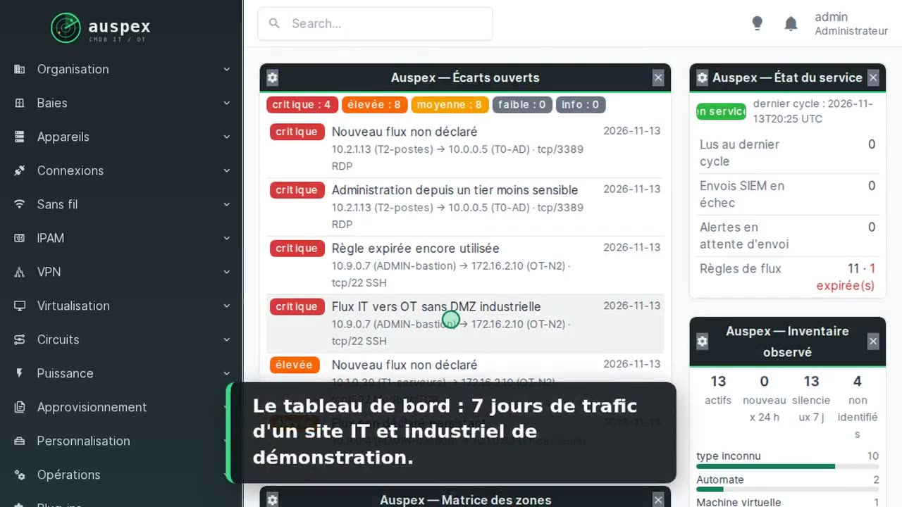

# Auspex

[](https://github.com/Jezu-CI/AUSPEX/actions/workflows/ci.yml)
[](https://www.bestpractices.dev/projects/16662)
[](https://scorecard.dev/viewer/?uri=github.com/Jezu-CI/AUSPEX)
[](https://github.com/Jezu-CI/AUSPEX/actions/workflows/captures-reelles.yml)
[](https://github.com/Jezu-CI/AUSPEX/releases/latest)
[](LICENSE)
[](https://jezu-ci.github.io/AUSPEX/)

*CMDB open source passive IT/OT — v0.2 « Lantern in the Void »*

**Site du projet : [jezu-ci.github.io/AUSPEX](https://jezu-ci.github.io/AUSPEX/)** — documentation, captures d'écran, téléchargement.

[](https://jezu-ci.github.io/AUSPEX/#video)

*▶ [Auspex en vidéo, en deux minutes](https://jezu-ci.github.io/AUSPEX/#video) : tableau de bord, écarts de segmentation, carte des flux, rapport d'audit NIS2 signé.*

À Rome, l'auspex lisait les présages en observant le vol des oiseaux, sans
jamais intervenir. C'est le principe de l'outil : tout voir, ne rien émettre.

Auspex est une **CMDB open source** qui se remplit en écoutant le réseau :
inventaire des actifs et contrôle de la segmentation réseau **par écoute
passive**, sans agent, sans compte de service, sans émettre un seul paquet
sur les réseaux surveillés. Conçu pour les environnements IT et industriels
(OT), et pour produire les preuves attendues par NIS2, DORA et l'IEC 62443.

*Aucun flux non déclaré n'échappe au regard de l'Auspex. Pour l'Empereur.*

> **État du projet : v0.2, déployable, versions signées.** Central complet (NetBox + Auspex en
> docker compose), capteur Docker et appliance ISO, identification IT/OT,
> conformité des flux, alertes SIEM, tableau de bord et carte, exports d'audit
> signés, authentification forte (MFA, clé de sécurité, carte à puce, LDAPS,
> OIDC, SAML). Chaque fonctionnalité est prouvée en CI sur le vrai produit :
> vrai Zeek, vrai NetBox, vrai navigateur, appliance démarrée en machine
> virtuelle, captures industrielles réelles (voir
> [docs/06-preuves-ci.md](docs/06-preuves-ci.md) et le
> [journal des versions](CHANGELOG.md)).

## Ce que fait la version actuelle

À partir de logs Zeek (JSON ou TSV, compressés ou non) :

- **Inventaire identifié** : famille et version d'OS, type d'équipement,
  fabricant, modèle, firmware, rôles (contrôleur de domaine, DNS, automate,
  maître Modbus...), chacun avec un **score de confiance** et la **liste des
  indices** qui l'ont produit.
- **Conformité des flux** : chaque flux entre zones est comparé aux règles
  déclarées dans un fichier **CSV ou XLSX**. Écarts détectés :

  | Écart | Exemple |
  | --- | --- |
  | Nouveau flux non déclaré | RDP d'un poste vers un serveur |
  | Flux non déclaré persistant | SSH ouvert pour un dépannage, jamais refermé |
  | Règle expirée encore utilisée | accès prestataire au-delà de la date prévue |
  | Règle jamais utilisée | règle candidate au nettoyage |
  | Administration depuis un tier moins sensible | poste T2 en RDP sur un contrôleur de domaine T0 |
  | Flux IT vers OT sans DMZ industrielle | serveur qui interroge un automate en direct |
  | Balayage du réseau | poste compromis qui balaie l'atelier (une alerte par machine, résolue quand le balayage cesse) |

- **Alertes SIEM** : syslog RFC 5424 (UDP, TCP, TLS avec vérification du
  certificat) en CEF ou JSON, webhook HTTPS, fichier JSONL. Une alerte garde
  le même identifiant de l'ouverture à la résolution : pas de rafale de
  doublons. File d'attente sur disque si le SIEM est injoignable.
- **Références réglementaires** sur chaque écart (NIS2 / règlement
  2024/2690, IEC 62443, ISO 27001, modèle en tiers ANSSI).
- **Rôles industriels** : automates, IHM et stations d'ingénierie distingués
  (S7, Modbus, Omron), routeurs BACnet, machines qui balaient le réseau.

Et autour : capteur passif (Docker ou appliance ISO durcie, mises à jour
signées), synchronisation avec NetBox, tableau de bord et carte interactive,
exports d'audit signés (NIS2, DORA, IEC 62443, ISO 27001, ANSSI).

## Ce qu'Auspex ne voit pas

L'écoute passive ne connaît que ce qui passe devant les capteurs :

- un équipement **éteint ou silencieux**, ou un flux qui **ne traverse pas un
  lien écouté** (deux machines sur le même commutateur), restent invisibles ;
- le **contenu chiffré** n'est pas lu (seuls les échanges et ce qui est
  annoncé en clair le sont), et Auspex n'enregistre jamais le contenu du
  trafic ;
- des machines **derrière une traduction d'adresses** se confondent ;
- Auspex identifie versions et firmwares mais **ne les compare pas à une base
  de vulnérabilités**, et il **détecte sans bloquer**.

L'inventaire observé complète donc l'inventaire déclaré, il ne le remplace
pas, et les exports d'audit **aident à démontrer** la conformité sur le
périmètre écouté, sans la garantir. Détail et parades :
[Ce qu'Auspex voit, ce qu'il ne voit pas](https://jezu-ci.github.io/AUSPEX/utilisateur/limites/).

## Installer

Sur une machine Linux avec Docker (2 vCPU, 4 Go de RAM) :

```bash
git clone https://github.com/Jezu-CI/AUSPEX.git auspex && cd auspex/deploy
./install.sh
```

L'installation construit et démarre le central (NetBox + Auspex), puis un
assistant demande le nom de l'organisation, les zones du réseau et leurs
plages d'adresses, et l'éventuel SIEM : la configuration est écrite pour
vous. Il reste à raccorder un capteur sur un port miroir ou un TAP.

Pas à pas, avec la première connexion et le raccordement d'un capteur :
**[Installer et mettre en route Auspex](https://jezu-ci.github.io/AUSPEX/utilisateur/mise-en-route/)**.
Versions signées, appliance ISO du capteur et vérification des
téléchargements : [Télécharger](https://jezu-ci.github.io/AUSPEX/telecharger/).

## Essayer sans rien installer

Le scénario de démonstration (7 jours de trafic simulé d'un site IT/OT)
tourne avec Python 3.10 ou plus récent, sans Docker ni NetBox :

```bash
git clone https://github.com/Jezu-CI/AUSPEX.git auspex && cd auspex
pip install -e .
cd examples/demo && python generate_logs.py logs
auspex rules import --apply && auspex analyze --logs logs --now logs
auspex findings      # écarts ouverts
auspex assets        # inventaire identifié
```

Il contient volontairement un SSH de dépannage oublié, un RDP d'un poste vers
le contrôleur de domaine, un serveur qui interroge un automate en Modbus sans
passer par la DMZ et un accès prestataire couvert par une règle expirée : les
quatre sont détectés, le trafic Active Directory normal ne déclenche rien.

## Documentation

| Pour | Lire |
| --- | --- |
| utiliser Auspex au quotidien (sans technique) | [Guide utilisateur](https://jezu-ci.github.io/AUSPEX/utilisateur/) |
| installer, exploiter, configurer | [Guide d'installation et d'utilisation](GUIDE.md) |
| authentification, capteurs, audits, configuration, preuves, données traitées | [Documentation technique](docs/README.md) |
| signaler une vulnérabilité, engagements de sécurité | [SECURITY.md](SECURITY.md) |
| contribuer (règles d'identification, modules) | [CONTRIBUTING.md](CONTRIBUTING.md) |
| nouveautés de chaque version | [CHANGELOG.md](CHANGELOG.md) |

## Feuille de route

| Jalon | Contenu | État |
| --- | --- | --- |
| Cœur | analyse, fingerprinting, conformité, import CSV/XLSX, alertes SIEM, CLI | **fait** |
| J1 | image capteur (Zeek + ICSNPP), rejeu de pcaps en CI | **fait** (JA4+ retiré : licence FoxIO incompatible avec un usage monétisé) |
| J2–J3 | enrichissement des règles IT et OT à partir de captures réelles | **fait** (captures publiques ; à compléter par des captures de terrain) |
| J4 | écriture dans NetBox (observé / déclaré), champs NIS2 / DORA | **fait** |
| J6 | `plan / apply`, service continu, docker compose, mise à jour avec retour arrière, modules, sauvegardes | **fait** |
| J7 | plugin NetBox : trusted hosts, MFA, LDAPS / OIDC / SAML, tableau de bord, carte interactive | **fait** |
| J8 | exports d'audit signés par référentiel (NIS2, DORA, IEC 62443, ISO 27001, ANSSI) | **fait** |
| J9 | ISO durcie du capteur, envoi des logs au central, WebAuthn, carte à puce, mises à jour signées | **fait** |
| v0.2 | versions signées (Sigstore, provenance SLSA), alerte SIEM sur les balayages, miroir des empreintes hors GitHub, OpenSSF Scorecard, fuzzing des données externes | **fait** |
| v0.3 | captures de terrain, Scorecard (critères liés à l'ancienneté du projet), accessibilité (contrastes, carte sans code couleur seul) | [à venir](https://github.com/Jezu-CI/AUSPEX/milestone/2) |

## Noms de version

Chaque version porte un nom de code :

| Version | Nom de code |
| --- | --- |
| 0.1 | Silence Before Dawn |
| 0.2 | Lantern in the Void |

## Licence

[GNU AGPL v3](LICENSE), avec un terme additionnel d'attribution ([NOTICE](NOTICE)).

En clair : vous pouvez utiliser Auspex librement, y compris en entreprise, le
modifier et le redistribuer. En échange, toute version modifiée mise à
disposition d'autres personnes, **y compris comme service en ligne**, doit
publier son code source sous la même licence, et conserver la mention
« Basé sur Auspex, projet conçu par Yann Mathon ».

Projet conçu par Yann Mathon ; code développé avec l'assistance de Claude
(Anthropic). Les versions jusqu'à la 0.1.0 incluse ont été publiées sous
licence Apache 2.0.
