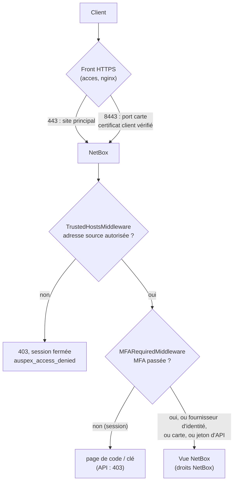
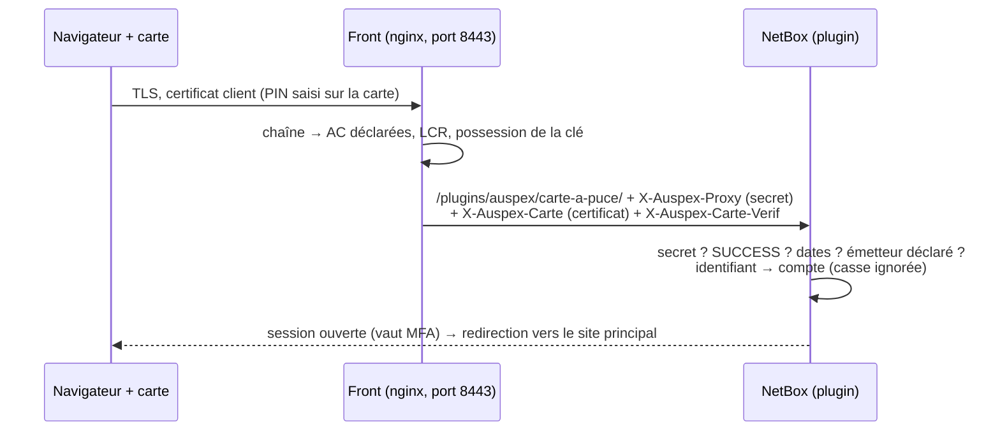

# 4. Authentification et accès

Toute la logique de décision vit dans `src/auspex/` (`access.py`, `mfa.py`,
`webauthn.py`, `carte.py`, `netbox_auth.py`), testée sans Django ; le
plugin NetBox ne fait que l'appeler. Tous les événements sont journalisés
en JSON sur le journal de NetBox (logger `netbox_auspex`), sans jamais de
secret, de code ni de mot de passe.

## Chaîne de contrôle d'une requête

L'ordre est voulu : l'adresse source d'abord (refus immédiat, avant même de
demander un code), puis la double authentification, puis les droits NetBox
ordinaires.

## Restriction par adresse source (trusted hosts)

Décision (`access.py`), pour chaque requête authentifiée, session **et**
jeton d'API (le jeton est identifié dans le middleware, avant toute action ;
une identification qui échoue de façon inattendue refuse la requête) :

1. **Adresse réelle** : celle de la connexion. `X-Forwarded-For` n'est lu
   que si la connexion vient d'un proxy déclaré (`access.trusted_proxies`)
   ou du front d'Auspex (adresse fixe `AUSPEX_FRONT_IP`, qui écrit lui-même
   l'en-tête). La chaîne est remontée depuis la droite : la première
   adresse qui n'est pas un proxy de confiance est le client ; si toutes en
   sont, le client est la plus à gauche (jamais l'adresse du front lui-même).
2. **Compte de service Librarian** : seulement depuis le réseau Docker
   interne du central.
3. **Administrateur local et brise-glace** : depuis la machine du central
   (boucle locale, passerelle du réseau interne) et le réseau interne
   (scripts d'installation) ; le brise-glace aussi depuis ses adresses
   `allow`.
4. **Autres utilisateurs** : règles par utilisateur ou par groupe
   (`access.trusted_hosts`) ; sans règle, politique par défaut
   (`deny_if_unlisted`, ou `allow_if_unlisted`).
5. **Configuration absente ou invalide** : **verrouillage** — seuls
   l'administrateur local (machine du central, réseau interne) et Librarian
   (réseau interne) restent acceptés. Volontairement **pas** « tout le monde
   depuis la machine » : un reverse proxy local ferait alors tout passer.

`auspex.yaml` est relu dès qu'il change (sans redémarrage). Refus : HTTP
403, session fermée, `auspex_access_denied` ; verrouillage :
`auspex_access_lockdown`. Un `0.0.0.0/0` est refusé à la validation.

## Méthode principale de connexion (`auth.primary`)

`netbox_auth.py` traduit `auth` en réglages NetBox (`deploy/netbox/plugins.py`
les lit au démarrage ; après une modification : `docker compose up -d
--force-recreate netbox`).

| Méthode | Mécanisme | Secret (dans `.env`, donné à NetBox seul) | MFA |
| --- | --- | --- | --- |
| aucune | comptes locaux NetBox | — | exigée (Auspex) |
| `ldaps` | django-auth-ldap, `ldaps://` ou `ldap://` + StartTLS | `AUSPEX_LDAP_BIND_PASSWORD` | exigée (Auspex) |
| `oidc` | social-auth OIDC, découverte depuis `issuer` | `AUSPEX_OIDC_CLIENT_SECRET` | celle du fournisseur |
| `saml` | social-auth SAML 2.0, métadonnées du fournisseur | — | celle du fournisseur |
| carte à puce | certificat client, port dédié du front | `AUSPEX_PROXY_SECRET` | la carte la vaut |

Règles communes :

- **Chiffrement obligatoire, certificats vérifiés** : `ldap://` en clair,
  émetteur OIDC en `http://`, métadonnées SAML vers `http://` sont refusés à
  la validation ; la vérification ne se désactive pas (`ca_file` pour une
  autorité interne).
- **Groupe exigé** (`require_group`) vérifié **avant** toute création de
  compte ; groupes recopiés dans NetBox à chaque connexion (droits et règles
  trusted hosts par groupe) ; administrateur NetBox seulement via
  `superuser_group`.
- **Jamais de rattachement par e-mail** : un compte du fournisseur n'est
  jamais lié à un compte local existant parce qu'il porte la même adresse.
- **Comptes locaux refusés** dès qu'une méthode principale est choisie, sauf
  brise-glace et administrateur local (`auspex_auth_local_refused`).
- SAML : assertions signées par le certificat des métadonnées obligatoires,
  algorithmes obsolètes refusés ; une assertion modifiée est rejetée.
- Événements : `auspex_sso_login`, `auspex_sso_refused`.

## Double authentification (MFA)

Exigée pour toute **session** qui ne vient pas d'un fournisseur d'identité ni
d'une carte : comptes locaux (brise-glace compris) et LDAPS. Un mécanisme de
connexion inconnu exige la MFA (en cas de doute, on demande). Les jetons
d'API ne portent pas de session : ils sont limités par les trusted hosts.

Tant que la MFA n'est pas passée, tout est refusé (redirection, ou 403 pour
l'API), sauf les pages de connexion, de déconnexion et de MFA.

**TOTP** (`mfa.py`, RFC 6238, testé avec les vecteurs officiels) : secret de
160 bits, codes à 6 chiffres, période 30 s, HMAC-SHA1, tolérance d'une
période ; **anti-rejeu** (un code accepté ne l'est plus, ni aucun plus
ancien). Inscription par QR code (généré sans dépendance, `qrcode.py`) ou
saisie de la clé, confirmée par un premier code.

**Code par e-mail** (si `email` figure dans `methods`) : 8 chiffres,
valable 10 minutes, 1 envoi par minute et 5 par heure au plus ; l'e-mail
indique l'adresse du poste qui se connecte. Serveur SMTP toujours vérifié
(`starttls` ou `tls` ; `none` = sans chiffrement, à réserver à un relais interne). Jamais proposé au
brise-glace, qui doit fonctionner messagerie en panne.

**Codes de secours** : 10 codes à usage unique, montrés une seule fois,
conservés uniquement en empreinte.

**Verrouillage progressif** : après 5 échecs, 5 minutes, puis 10, 20…
jusqu'à 24 h tant qu'aucune connexion ne réussit
(`auspex_mfa_locked`, `auspex_mfa_refused_locked`).

**Administration** : `manage.py auspex_mfa status | unlock <user> | reset
<user>` (le reset révoque aussi les clés WebAuthn) ; chaque commande
journalise son événement.

Événements : `auspex_mfa_enroll`, `auspex_mfa_enrolled`, `auspex_mfa_ok`,
`auspex_mfa_failed`, `auspex_mfa_locked`, `auspex_mfa_email_sent`,
`auspex_mfa_email_error`.

## Clé de sécurité (WebAuthn)

Implémentation propre (`webauthn.py`, sans bibliothèque tierce) :

- **CBOR / COSE** décodés avec bornes strictes (profondeur, tailles,
  longueurs) ; algorithmes acceptés : Ed25519 (-8), ES256 (-7), RS256
  (-257, clé ≥ 2048 bits).
- **Défi** de 32 octets, à usage unique, valable 5 minutes, conservé en
  session ; une réponse rejouée est refusée.
- Vérifications à l'inscription comme à la connexion : type
  (`webauthn.create` / `webauthn.get`), défi, **origine exacte**
  (`mfa.webauthn.adresse`), empreinte du domaine (`rpId` = `domaine`),
  présence de l'utilisateur (UP), vérification de l'utilisateur (UV) si
  `exiger_code: true`, refus des requêtes `crossOrigin`.
- **Attestation `none`** : Auspex n'exige pas de modèle de clé particulier.
- **Compteur de signatures** : un compteur qui n'avance pas (alors qu'il
  n'est pas nul) signale une clé clonée et refuse la connexion ; les clés
  sans compteur (passkeys synchronisées, compteur toujours 0) sont acceptées.
- **Identifiant utilisateur opaque** : `HMAC(SECRET_KEY, id)` tronqué, sans
  nom ni adresse.
- Seule la **clé publique** est conservée (`WebAuthnKey`) ; la page « Mes
  clés de sécurité » ajoute une clé de secours et en retire une (jamais la
  dernière).
- Le navigateur lie la clé au domaine : elle ne répond pas sur un site
  d'hameçonnage. HTTPS obligatoire (sauf `localhost`), `domaine` doit être
  un nom (pas une IP) et un suffixe du nom de `adresse`.

Événements : `auspex_mfa_ok` (méthode `webauthn`), `auspex_webauthn_refused`,
`auspex_webauthn_key_added`, `auspex_webauthn_key_removed`.

## Carte à puce

- **Port dédié** : seul le port carte demande un certificat
  (`ssl_verify_client optional`) ; le site principal ne déclenche jamais de
  fenêtre de choix de certificat. Une vérification échouée (codes nginx 495
  / 496) est renvoyée vers la page de refus, pas vers une erreur brute.
- **Le front fait la cryptographie** : chaîne jusqu'aux autorités
  `autorites`, révocation (`revocation`, LCR PEM), preuve de possession de
  la clé privée (donc de la carte et de son PIN).
- **NetBox ne croit que le front** : en-tête `X-Auspex-Proxy` égal au
  secret `AUSPEX_PROXY_SECRET` (64 hexadécimaux, comparaison à temps
  constant). Le front **efface** ces en-têtes sur le site principal : des
  en-têtes forgés, envoyés au site principal ou directement à NetBox, sont
  refusés.
- **Contrôles refaits par NetBox** (gratuits) : vérification `SUCCESS`,
  période de validité, émetteur parmi les autorités déclarées.
- **Identifiant** → compte NetBox selon `identifiant` : `upn` (UPN
  Microsoft, OID 1.3.6.1.4.1.311.20.2.3), `upn_court` (partie avant `@`),
  `email`, `cn`. La valeur doit respecter les règles de nom d'utilisateur de
  Django (`[\w.@+-]{1,150}`). Recherche **insensible à la casse** ; refus si
  deux comptes ne diffèrent que par la casse.
- **Comptes protégés** : administrateur local et brise-glace ne se
  connectent **jamais** par carte (toujours compte local + MFA).
- `creer_comptes: true` : compte créé au premier passage, **sans aucun
  droit** et sans mot de passe utilisable (`auspex_carte_account_created`).
- Les trusted hosts s'appliquent comme à toute connexion.
- **LCR** : `auspex plan` prévient 7 jours avant l'échéance ; une LCR
  périmée fait refuser **toutes** les cartes (comportement de nginx), d'où
  la note dans le plan.
- Le bloc nginx du port carte est écrit par le service dans
  `data/state/acces/carte.conf` ; le front se recharge seul quand il change.

Événements : `auspex_carte_ok` (sujet, émetteur, numéro de série),
`auspex_carte_refused` (motif), et côté front le journal JSON d'accès avec
`carte_sujet`.

## Compte brise-glace

`auth.break_glass` désigne le compte local qui reste utilisable quand
l'annuaire ou le fournisseur d'identité est indisponible :

- toujours compte local + MFA (`mfa: totp` ou `webauthn`, jamais e-mail) ;
- accepté seulement depuis la machine du central et ses adresses `allow` ;
- jamais par carte à puce ;
- à utiliser rarement : chaque connexion est journalisée.
