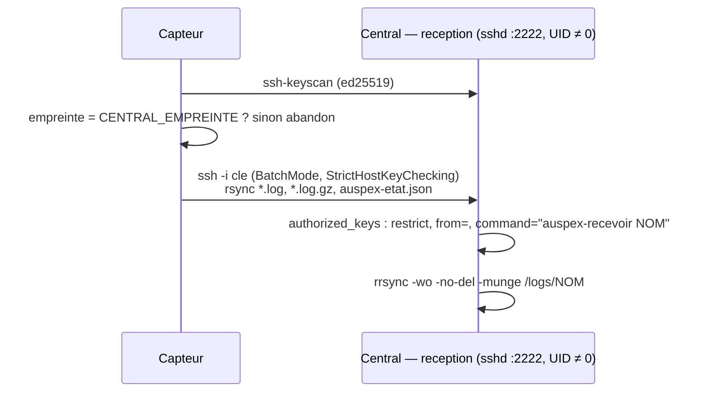
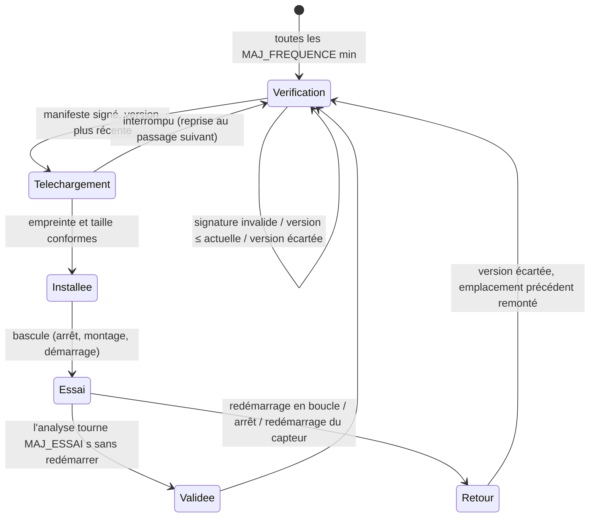

# 5. Capteurs

Un capteur écoute un port miroir (SPAN) ou un TAP, produit des logs Zeek et
les envoie au central. Deux formes : l'**image Docker** (`sensor/`) sur une
machine existante, ou l'**appliance** (`appliance/`), une ISO Debian 12
dédiée, durcie, qui embarque la même image.

## Image d'analyse (`sensor/`)

- **Zeek** avec les parsers industriels **ICSNPP** de la CISA
  (EtherNet/IP-CIP, S7comm, Modbus, DNP3, BACnet, OPC UA, FINS, HART-IP,
  GE-SRTP, PROFINET). JA4+ (FoxIO) n'est pas embarqué : sa licence interdit
  l'usage monétisé sans licence OEM.
- `entrypoint.sh` : `read <pcap…>` (analyse de captures, réseau coupé),
  `live <interface>` (écoute continue), `cle` (clé d'envoi, créée au premier
  appel), `envoyer` (un envoi), `version` (versions de Zeek et des paquets).
- En écoute continue : rotation horaire des logs, purge après 48 h
  (`AUSPEX_SENSOR_RETENTION_HOURS`), envoi toutes les minutes
  (`AUSPEX_ENVOI_SECONDES`).
- Seules capacités nécessaires : `NET_RAW` et `NET_ADMIN` (capture et
  réglage de l'interface) ; aucun port ouvert.

## Envoi des logs au central



**Côté capteur** : la clé d'hôte du central est relevée puis **comparée à
l'empreinte épinglée** (`CENTRAL_EMPREINTE`, donnée par `auspex capteur
empreinte`) avant tout envoi ; un faux central ne reçoit rien.

**Côté central** (`deploy/reception/`, `reception.py`) :

- `sshd` sans privilèges (UID du service), système en lecture seule, clés
  Ed25519 uniquement, pas de mot de passe, pas de shell, pas de
  redirection (option `restrict`, et `DisableForwarding`, `PermitTTY no`
  dans `sshd_config`) ; échange de clés `sntrup761x25519` (hybride
  post-quantique) ou `curve25519`, chiffrement ChaCha20-Poly1305 ou
  AES-256-GCM ; 3 tentatives et une session par connexion au plus ;
- `authorized_keys` **généré** par Auspex depuis `sensors[].key` de
  `auspex.yaml` à chaque cycle : retirer un capteur révoque sa clé ;
  `from="…"` reprend `sensors[].allow` ;
- commande imposée `auspex-recevoir NOM` : écriture seule, sans suppression,
  liens symboliques neutralisés (`rrsync -wo -no-del -munge`), dans le seul
  dossier `logs/NOM/` ;
- purge des logs reçus après 30 jours (`AUSPEX_LOGS_RETENTION_DAYS`).

`auspex capteur liste` : capteurs déclarés, autorisés, dernier dépôt, version
d'analyse et résultat de la dernière mise à jour.

## Appliance (ISO)

Construite par `appliance/build.sh` (live-build, Debian 12) à partir de
l'image Docker testée en CI (`tools/appliance-rootfs.sh` en extrait la
racine, sans les outils de compilation). Produit
`auspex-capteur-<version>.iso` et `auspex-capteur-<version>.squashfs`
(image de mise à jour).

### Séquence de démarrage

| Ordre | Unité | Rôle |
| --- | --- | --- |
| 1 | `auspex-silence` | avant tout réseau : netdev `egress` drop sur **toutes** les cartes physiques |
| 2 | `auspex-donnees` | disque `AUSPEX-DATA` monté ; un disque **entièrement vide** (≥ 256 Mio, lu en entier) est formaté, jamais un autre |
| 3 | `auspex-config` | import depuis le support `AUSPEX-CONF` (`capteur.conf`, clé `cle`/`cle.pub` copiée en 600), clé créée sinon ; configuration validée ; interfaces résolues |
| 4 | `auspex-parefeu` | nftables : sorties de l'administration limitées au central, DNS, NTP, DHCP ; écoute muette |
| 5 | `auspex-reseau` | fichiers systemd-networkd écrits **avant** que networkd démarre ; écoute sans adresse |
| 6 | `auspex-racine` | image d'analyse choisie, vérifiée, montée en lecture seule (voir mises à jour) |
| 7 | `auspex-capteur` | Zeek sur `/run/auspex/racine` |
| 8 | `auspex-maj` | mises à jour signées |
| — | `auspex-console` | écran d'état et menu de configuration (tty1) |

### Durcissement

- **Système en lecture seule** (image live) ; seuls la clé, la
  configuration, les logs récents et les emplacements de mise à jour sont
  sur le disque de données.
- **Interface d'écoute muette** : pas d'adresse, pas d'ARP, pas d'IPv6
  (`ipv6.disable=1`), et un filtre `egress` qui jette toute trame sortante.
  `ifupdown` et `dhclient` sont **purgés** (live-boot les lançait sur toutes
  les interfaces) ; seul systemd-networkd, piloté par `auspex-reseau`,
  configure le réseau, et un fichier par défaut `Unmanaged=yes` couvre toute
  interface inconnue.
- **Aucun compte** : pas de serveur SSH, `getty` masqués (console et série),
  root verrouillé, shell `nologin`, pas de paquet `live-config` (compte
  « user » connu) ; aucun dépôt APT.
- **Analyse confinée** : `auspex-capteur` tourne avec `RootDirectory`
  (racine en lecture seule), seules capacités `CAP_NET_RAW` et
  `CAP_NET_ADMIN`, `NoNewPrivileges`, `Protect*`, familles d'adresses
  limitées, appels système natifs seulement.
- **`capteur.conf` jamais exécuté** : lu ligne à ligne, chaque clé validée
  par une expression régulière (`lib.sh`, `valid`) ; une valeur ne peut pas
  injecter de commande.

### `capteur.conf`

Voir [référence](05-configuration.md#capteurconf-appliance).

## Mises à jour signées de l'analyse (A/B)

L'analyse (Zeek, ICSNPP, scripts) évolue plus souvent que le système :
elle se met à jour par le réseau. Le système (noyau, pare-feu, scripts de
démarrage) se met à jour en démarrant une nouvelle ISO.

### Publication (central, `maj.py`)

1. `auspex capteur cle-maj` : crée au besoin la clé Ed25519 de mises à jour
   (`data/state/cles/maj-capteurs-ed25519.pem`, 600, **distincte** de la clé
   des audits) et affiche la ligne `MAJ_CLE=` (SubjectPublicKeyInfo DER en
   base64, 60 caractères).
2. `auspex capteur publier auspex-capteur-<v>.squashfs` : vérifie la version
   (chiffres et points, plus récente que la publication en cours sauf
   `--force`), la taille (≤ 2 Gio) et la signature de format squashfs
   (`hsqs`) ; copie l'image, calcule l'empreinte **de la copie**, écrit et
   signe le manifeste ; bascule atomique `courant/` ← nouvelle publication,
   l'ancienne devient `precedent/`.

Manifeste (`data/mises-a-jour/courant/manifeste`, texte, signé tel quel ;
signature brute de 64 octets dans `manifeste.sig`) :

```
format=auspex-maj-capteur/1
version=0.2.0
sha256=<64 hexadécimaux>
taille=<octets>
publie_le=2026-11-01T12:00:00Z
```

### Distribution

La réception sert `data/mises-a-jour/` (monté en lecture seule) : quand la
commande rsync demandée est une **lecture** (`rsync --server --sender`),
`auspex-recevoir` exécute `rrsync -ro /mises-a-jour` ; tout le reste reste
un dépôt de logs en écriture seule. Même clé SSH, même port, même
épinglage : aucun nouveau flux à ouvrir dans les pare-feux.

### Installation sur le capteur (`auspex-maj`, `maj.sh`)



- **Vérification** : manifeste ≤ 4 Kio, signature de 64 octets, vérifiée par
  `openssl pkeyutl -verify -rawin` avec `MAJ_CLE` ; chaque ligne du
  manifeste validée par expression régulière (rien n'est exécuté), format,
  version, empreinte et taille contrôlés.
- **Pas de retour en arrière imposé** : seule une version **strictement
  plus récente** (`sort -V`) que la version active est installée.
- **Téléchargement** dans `maj/telechargement/` ; l'image active y est
  d'abord copiée comme base, rsync ne transfère que les différences ;
  `--partial` permet la reprise ; place libre vérifiée (taille + 10 % +
  50 Mio).
- **Deux emplacements** `maj/a` et `maj/b` + l'image d'usine (ISO) :
  l'installation se fait toujours dans l'emplacement **inactif**.
- **État** (`maj/etat`, lu clé par clé) : `actif`, `precedent`, `essai`,
  `refusees` (20 dernières versions écartées).
- **Essai** : l'analyse doit tourner `MAJ_ESSAI` secondes (300 par défaut)
  sans aucun redémarrage (`NRestarts` = 0) et être active à la fin. Sinon :
  version écartée, retour à l'emplacement précédent. Un capteur qui
  redémarre pendant l'essai (`essai=1` au démarrage) abandonne aussi la
  version.
- **À chaque démarrage** (`auspex-racine`), l'emplacement actif est
  **revérifié** (signature et empreinte complète) et doit être plus récent
  que l'ISO ; sinon l'image d'usine est utilisée. Montage `squashfs`
  `ro,nodev,nosuid` sur `/run/auspex/racine` ; seules les variables `PATH`,
  `ZEEK*`, `LANG` de l'image sont reprises.
- **État visible du central** : `auspex-etat.json` (version d'analyse,
  emplacement, version du système, dernier événement) envoyé avec les logs,
  affiché par `auspex capteur liste`.
- Sans `MAJ_CLE` dans `capteur.conf`, les mises à jour sont désactivées.

### Limites

- La clé publique de confiance est lue dans `capteur.conf`, sur le disque
  de données : qui a un accès physique au disque peut remplacer la clé et
  l'image (il pourrait de toute façon modifier la configuration).
- La signature est celle de l'**organisation** (clé du central) : elle
  prouve que l'image a été publiée par votre central, pas qu'elle provient
  du projet. Vérifier l'empreinte publiée avec chaque version avant de
  publier.
