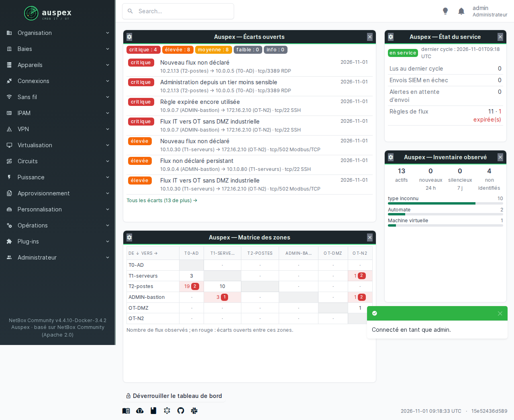
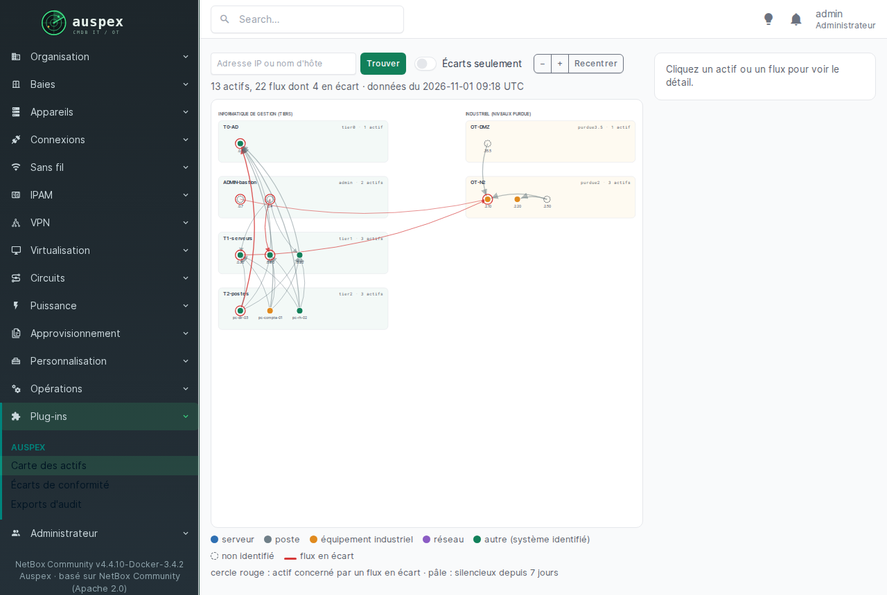
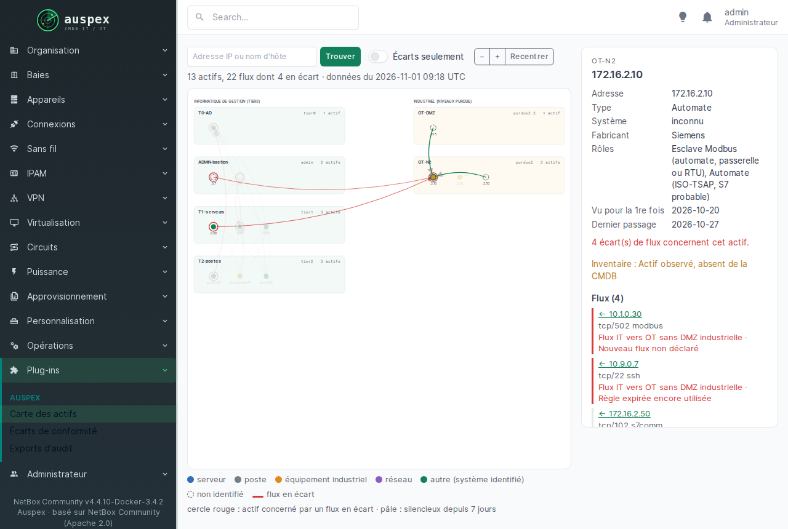
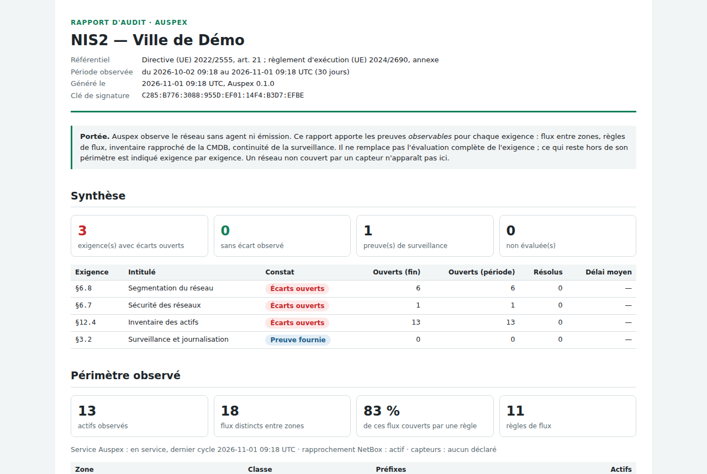
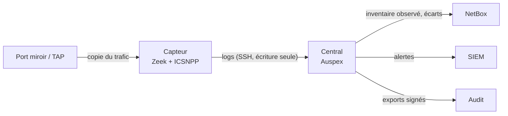

# Auspex

**Inventaire des actifs et contrôle de la segmentation réseau par écoute
passive**, pour les environnements IT et industriels (OT). Sans agent, sans
compte de service, sans émettre un seul paquet sur les réseaux surveillés.

[Télécharger](telecharger.md){ .md-button .md-button--primary }
[Documentation](guide.md){ .md-button }
[Code source](https://github.com/Jezu-CI/AUSPEX){ .md-button }

<small>Open source, licence AGPL v3 · conçu par Yann Mathon · [English summary](en/index.md){ hreflang=en lang=en }</small>

*À Rome, l'auspex lisait les présages en observant le vol des oiseaux, sans
jamais intervenir. C'est le principe de l'outil : tout voir, ne rien émettre.*

## Ce qu'Auspex apporte

-   :material-radar: **Inventaire observé, pas déclaré**

    ---

    Chaque actif vu sur le réseau est identifié (système, fabricant, modèle,
    firmware, rôle) avec un score de confiance et la liste de ses indices.
    Automates Siemens, superviseurs Niagara, passerelles HART, équipements
    Moxa, Hirschmann, RUGGEDCOM… IHM et stations d'ingénierie distinguées.

-   :material-shield-check: **Segmentation contrôlée en continu**

    ---

    Chaque flux entre zones est comparé aux règles déclarées (CSV ou Excel) :
    flux non déclarés, règles expirées encore utilisées, administration
    depuis un tier moins sensible, flux IT vers OT sans DMZ industrielle.

-   :material-file-certificate: **Preuves pour NIS2, DORA, IEC 62443**

    ---

    Exports d'audit signés par référentiel, vérifiables sans Auspex ; chaque
    écart porte ses références réglementaires ; alertes vers le SIEM.

-   :material-database-sync: **Intégré à NetBox**

    ---

    L'inventaire observé s'écrit à côté de l'inventaire déclaré, avec les
    écarts entre les deux. Tableau de bord, carte interactive, contrôle
    d'accès renforcé (MFA, clé de sécurité, carte à puce, LDAPS, OIDC, SAML).

## En images

<figure markdown>
  
  <figcaption>Tableau de bord : écarts ouverts, état du service, inventaire, matrice des zones</figcaption>
</figure>

<figure markdown>
  
  <figcaption>Carte : zones de gestion à gauche, zones industrielles à droite, flux en écart en rouge</figcaption>
</figure>

<figure markdown>
  
  <figcaption>Détail d'un actif : identification, indices, écarts et flux</figcaption>
</figure>

<figure markdown>
  
  <figcaption>Export d'audit NIS2 signé : constat par exigence</figcaption>
</figure>

[Toutes les captures d'écran](captures.md){ .md-button }

## Comment ça marche

1. **Le capteur écoute** un port miroir ou un TAP (image Docker, ou appliance
   ISO durcie dont l'interface d'écoute n'émet rien).
2. **Le central analyse** : identification des actifs, conformité des flux,
   rapprochement avec NetBox, alertes et exports d'audit.
3. **Les équipes consultent** dans NetBox, reçoivent les alertes dans leur
   SIEM, transmettent les exports aux auditeurs.

## Prouvé, pas promis

Chaque modification est vérifiée automatiquement sur le **vrai produit** :
installation complète du central, vrai NetBox, vrai navigateur, vrai
annuaire et vrais fournisseurs d'identité, appliance démarrée en machine
virtuelle (aucune trame émise sur l'écoute), et **captures industrielles
réelles** (66 identifications attendues, faux positifs compris).
[Le détail des preuves](documentation/06-preuves-ci.md).
