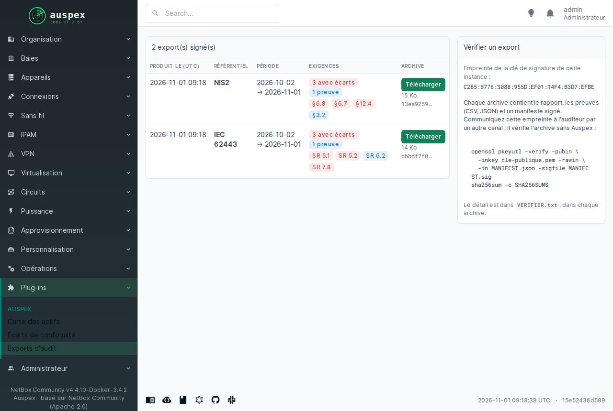
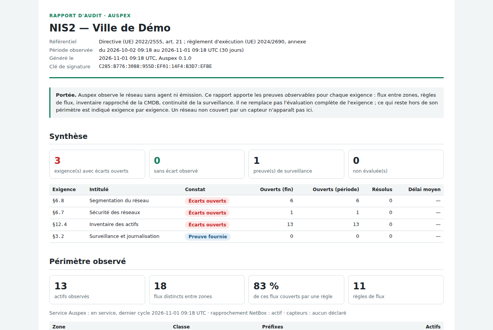
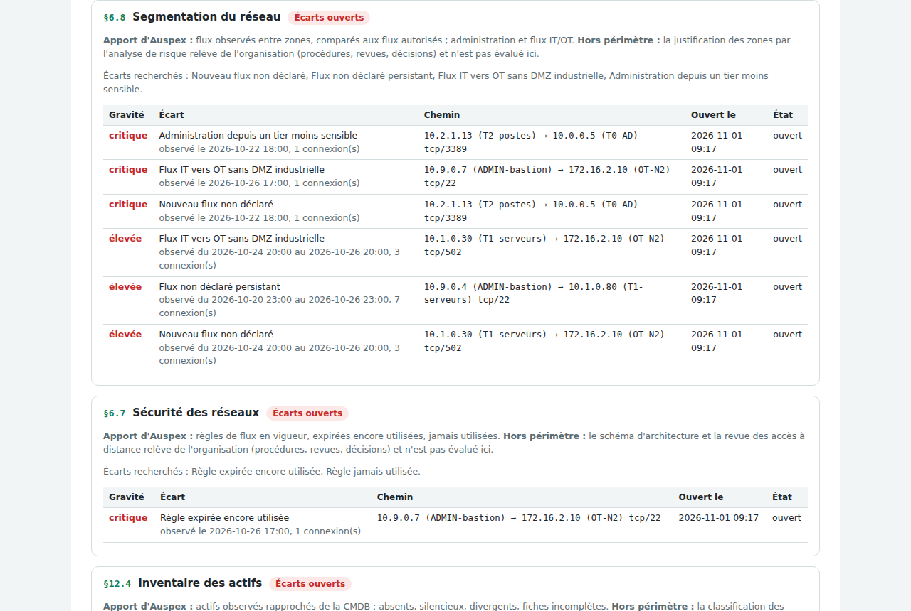

# Les rapports d'audit

Auspex produit des **rapports prêts à remettre à un auditeur**, un par
référentiel : NIS2, DORA, IEC 62443, ISO 27001 et les recommandations de
l'ANSSI. Ils prouvent ce que le réseau montre : votre inventaire, votre
segmentation, les écarts et le temps mis à les corriger.

## Trouver les rapports

Menu **Plug-ins → Auspex → Exports d'audit**. Chaque ligne est un rapport :
sa date, son référentiel, la période couverte, un résumé des exigences
(en rouge celles qui ont des écarts) et un bouton **Télécharger**.

{ loading=lazy }

Les rapports sont produits automatiquement (chaque mois, par défaut, pour les
référentiels choisis par votre administrateur). Pour un rapport à la demande,
par exemple sur les 90 derniers jours :

```bash
docker compose exec auspex auspex audit export nis2 --jours 90
```

## Ce que contient l'archive

| Fichier | Pour qui |
| --- | --- |
| le **rapport**, à ouvrir dans un navigateur et à imprimer | vous, votre direction, l'auditeur |
| les **preuves** en tableur (CSV) et en JSON : écarts, inventaire, règles, flux | l'auditeur qui veut vérifier les chiffres |
| un **manifeste signé** | la preuve que rien n'a été modifié |
| `VERIFIER.txt` | le mode d'emploi de la vérification |

## Lire le rapport

{ loading=lazy }

En tête, la **synthèse** : combien d'exigences ont des écarts ouverts,
combien n'en ont aucun, combien sont appuyées par une preuve, combien n'ont
pas pu être évaluées. Puis, pour chaque exigence, un constat :

| Constat | Ce qu'il veut dire |
| --- | --- |
| **Écarts ouverts** | au moins un écart ouvert concerne cette exigence. C'est le constat qui l'emporte sur tous les autres. |
| **Sans écart observé** | les données sont là et rien d'anormal n'a été vu sur la période |
| **Preuve fournie** | Auspex apporte une pièce (inventaire, règles, surveillance continue) sans porter de jugement |
| **Non évaluée** | la donnée manque : par exemple, aucune règle de flux chargée, ou inventaire non relié à NetBox |

Le **périmètre observé** suit : nombre d'actifs, flux entre zones, part de
ces flux couverte par une règle, capteurs déclarés.

{ loading=lazy }

!!! info "Ce que le rapport ne prétend pas"
    Pour chaque exigence, le rapport dit ce qu'Auspex prouve **et ce qui
    reste à évaluer ailleurs** : procédures, revues, organisation. Il ne
    remplace pas l'audit ; il en fournit la partie que le réseau peut
    démontrer. Un réseau qu'aucun capteur n'écoute n'y apparaît pas.

## Les exigences couvertes

| Référentiel | Exigences appuyées par Auspex |
| --- | --- |
| NIS2 (règlement 2024/2690) | §6.8 segmentation, §6.7 sécurité des réseaux, §12.4 inventaire, §3.2 surveillance |
| DORA | art. 13 (segmentation, flux documentés, réseau d'administration, règles de filtrage), art. 8 (inventaire) |
| IEC 62443-3-3 | SR 5.1, SR 5.2, SR 6.2, SR 7.8 |
| ISO/IEC 27001:2022 | A.8.22, A.8.20, A.5.9, A.8.16 |
| ANSSI | administration en tiers, cloisonnement et filtrage, systèmes industriels, cartographie |

## Transmettre un rapport à l'auditeur

1. Téléchargez l'archive et envoyez-la à l'auditeur.
2. **Par un autre canal** (téléphone, courrier, réunion), communiquez-lui
   l'**empreinte de la clé de signature**. Elle est affichée sur la page
   Exports d'audit, à droite.
3. L'auditeur vérifie l'archive **sans Auspex**, avec des outils standard,
   en suivant `VERIFIER.txt`. Si un seul fichier a été modifié, la
   vérification échoue.

Chaque rapport cite aussi l'empreinte du rapport précédent : il est
impossible d'en retirer un de la série sans que cela se voie.
