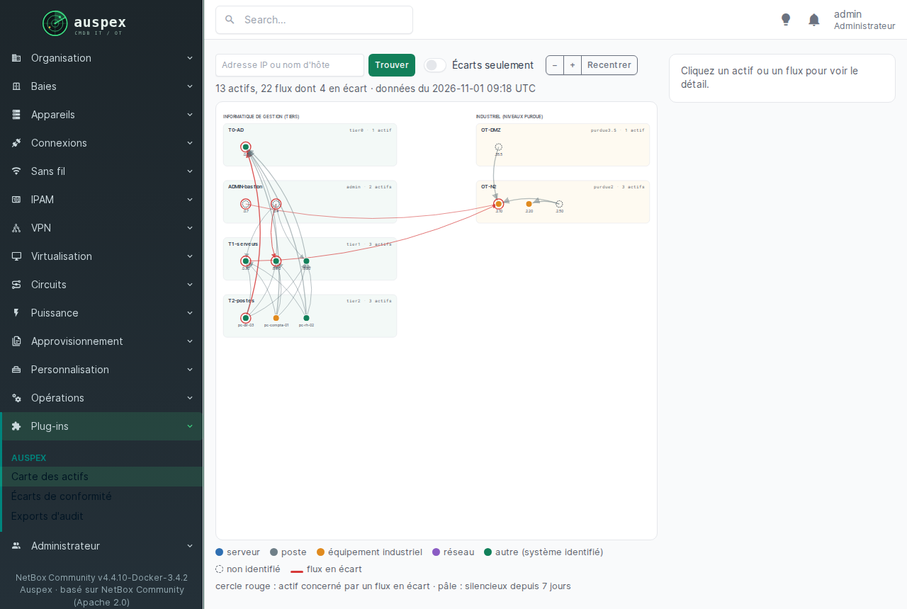
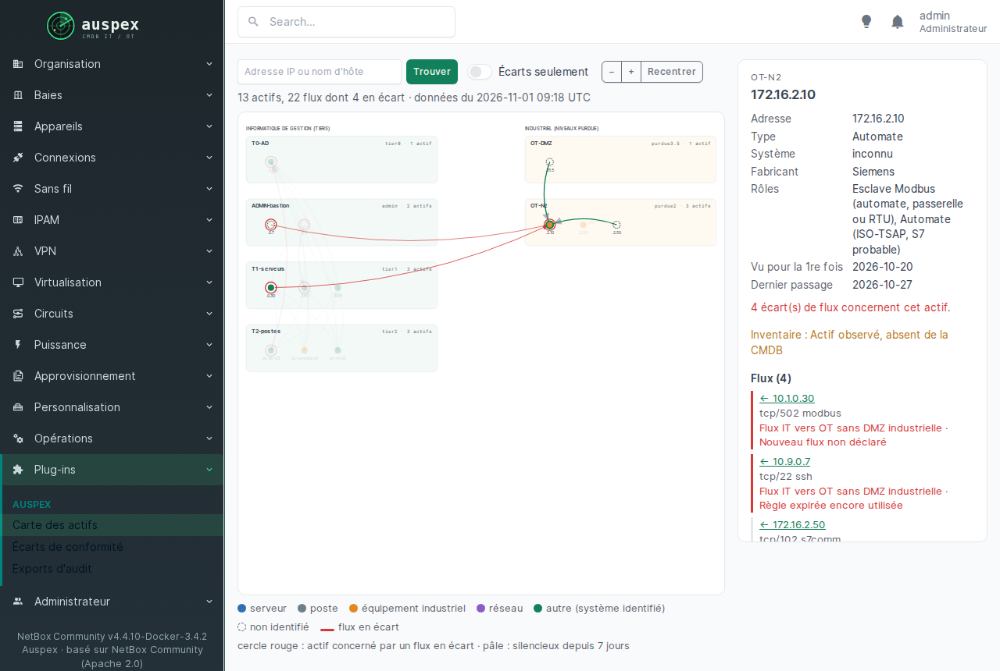
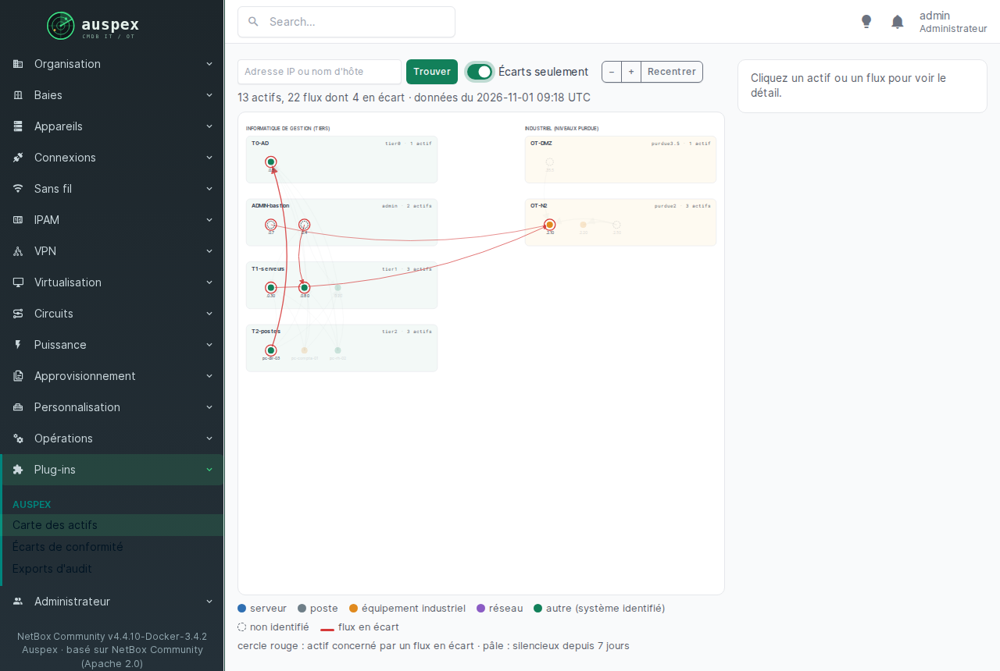

# La carte des actifs

Menu **Plug-ins → Auspex → Carte des actifs**. Toute votre architecture sur
une page : les zones, les machines dedans, et les flux entre elles.

{ loading=lazy }

## Lire la carte

- **À gauche, l'informatique de gestion**, rangée par tiers : tier 0,
  administration, tier 1, tier 2, DMZ.
- **À droite, le réseau industriel**, rangé par niveaux Purdue.
- Un trait qui **traverse la page** relie l'informatique de gestion à
  l'atelier. C'est là qu'il faut regarder en premier.

| Ce que vous voyez | Ce que ça veut dire |
| --- | --- |
| couleur du point | le type d'actif : serveur, poste, équipement industriel, réseau, autre |
| point en pointillés | actif non identifié |
| cercle rouge autour d'un point | l'actif est concerné par un écart |
| point pâle | silencieux depuis 7 jours |
| trait rouge | flux en écart |

## Explorer

- **Cliquez sur un actif** : le panneau de droite affiche son adresse, son
  type, son système, son fabricant, ses rôles, les dates où il a été vu, ses
  écarts et la liste de ses flux.
- **Cliquez sur un flux** : les ports, le volume et l'écart éventuel.
- **« Écarts seulement »** : ne garde que ce qui pose problème. Idéal pour
  une réunion.
- **Recherche** : tapez une adresse IP ou un nom de machine, puis « Trouver ».
- **Zoom** : molette de la souris ou boutons − et +, « Recentrer » pour
  revenir à la vue complète.

{ loading=lazy }

{ loading=lazy }

!!! info "Sur un très grand réseau"
    La carte affiche jusqu'à 1 500 actifs et 4 000 flux, en gardant d'abord
    ceux qui ont des écarts. Pour le reste, utilisez la page des écarts et
    l'inventaire de NetBox.
