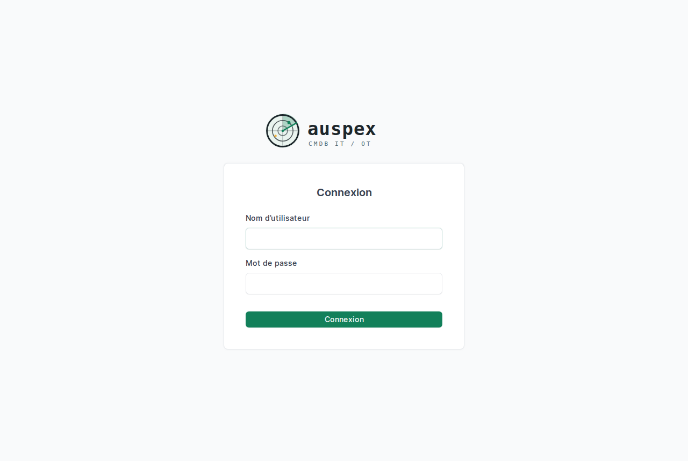
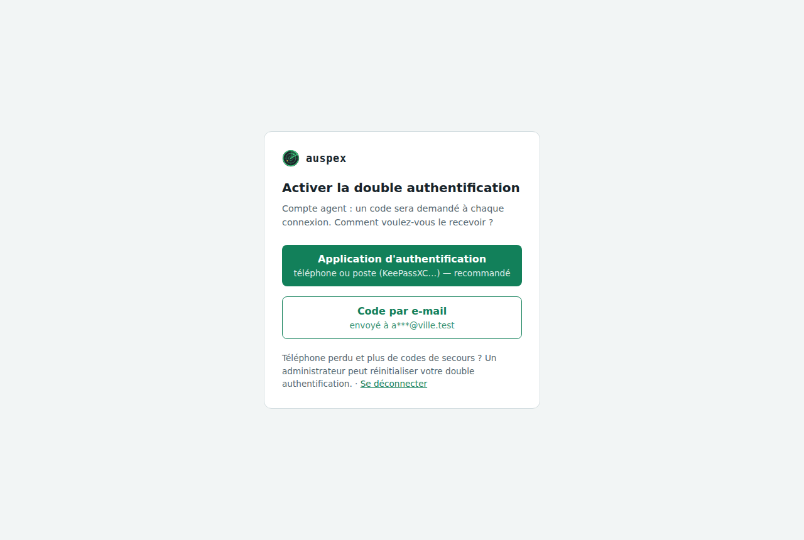
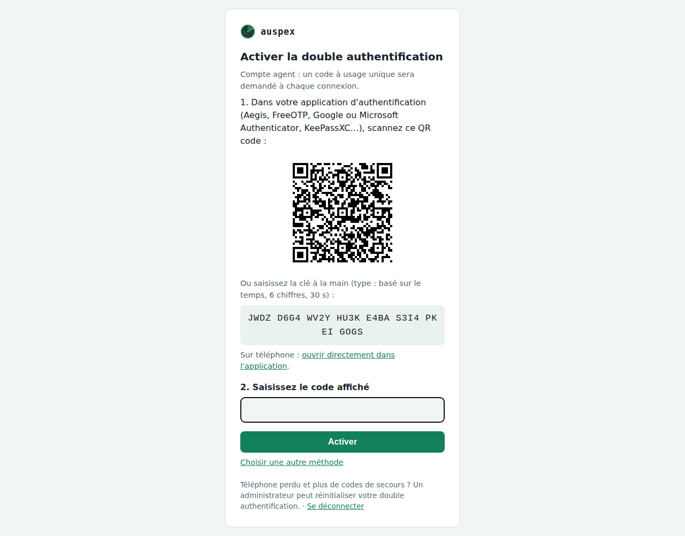
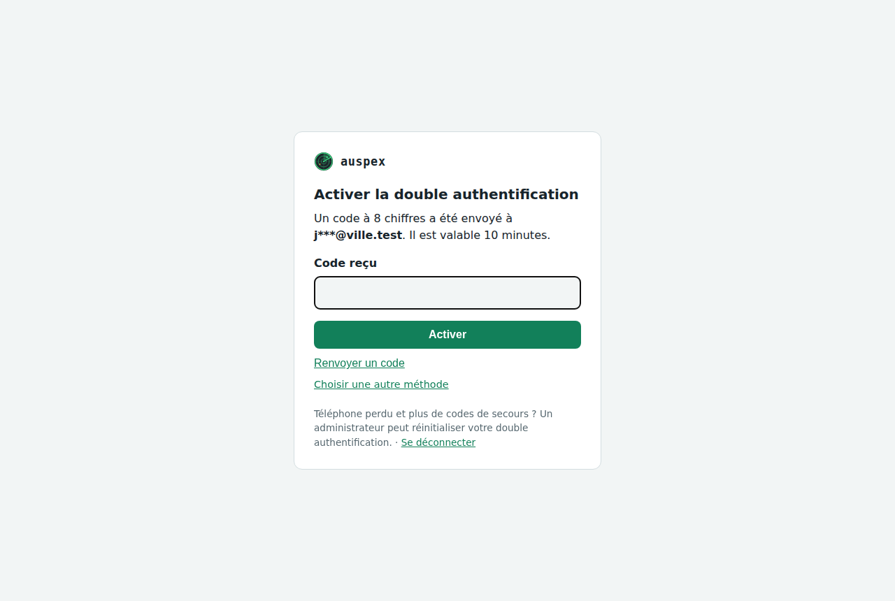
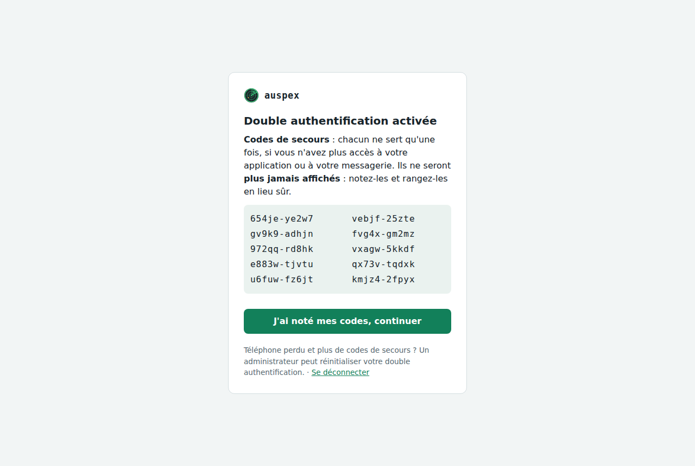
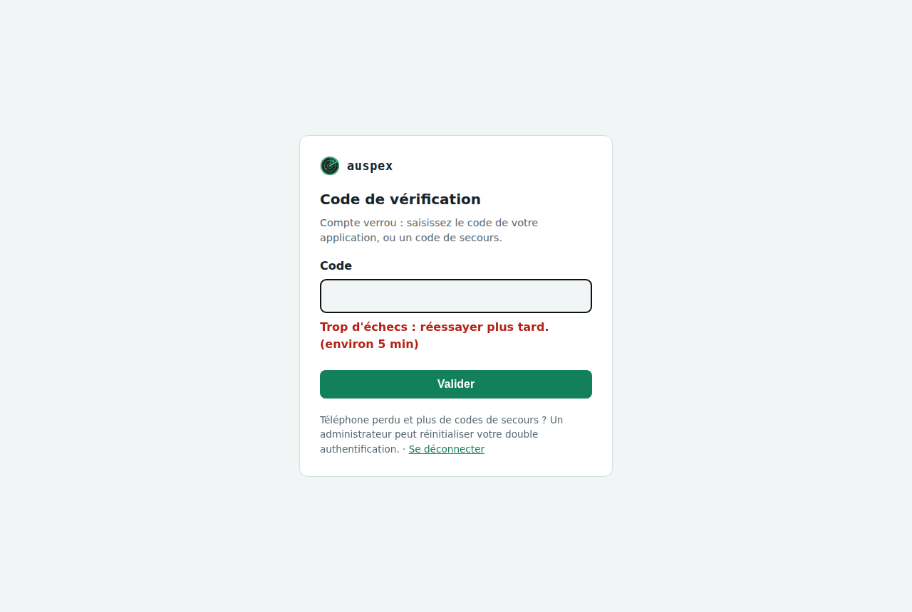

# Se connecter

Auspex se consulte dans **NetBox**, depuis un navigateur, à l'adresse que
vous a donnée votre administrateur (par exemple `https://auspex.ville.fr`).

Selon les choix de votre organisation, vous vous connectez de l'une de ces
façons :

| Ce que vous voyez sur la page de connexion | Ce que vous faites |
| --- | --- |
| identifiant et mot de passe seulement | votre compte NetBox ou votre compte Windows (annuaire), puis un **second facteur** |
| un bouton « Microsoft », « Google », « ADFS »… | vous passez par le portail de connexion habituel de votre organisation |
| un bouton « Connexion par carte à puce » | vous insérez votre carte d'agent et tapez son code |

{ loading=lazy }

## Première connexion : choisir son second facteur

Avec un identifiant et un mot de passe, Auspex demande toujours une deuxième
preuve. À la première connexion, vous choisissez laquelle.

{ loading=lazy }

### Une application d'authentification (recommandé)

1. Installez une application de codes sur votre téléphone (Microsoft ou
   Google Authenticator, Aegis, FreeOTP…) ou sur votre poste (KeePassXC
   sait aussi le faire).
2. Scannez le QR code affiché, ou recopiez la clé écrite en dessous.
3. Tapez le code à 6 chiffres que donne l'application pour confirmer.

{ loading=lazy }

### Un code reçu par e-mail

Pour les équipes sans téléphone professionnel, si votre administrateur l'a
activé. Le code fait 8 chiffres et reste valable 10 minutes. L'e-mail indique
l'adresse du poste qui demande la connexion : si ce n'est pas vous,
prévenez votre administrateur.

{ loading=lazy }

### Une clé de sécurité

Une clé USB (YubiKey…), Windows Hello ou le lecteur d'empreinte de votre
portable. C'est la méthode la plus sûre : la clé refuse de répondre à un faux
site, même parfaitement imité. Pensez à inscrire une **deuxième clé de
secours**, à ranger à part, depuis la page **Mes clés de sécurité**.

### Les codes de secours

Juste après l'inscription, Auspex affiche **10 codes de secours**, une seule
fois. Chacun permet de se connecter une fois si vous n'avez plus votre
téléphone ou votre clé. Imprimez-les ou rangez-les dans votre coffre-fort de
mots de passe.

{ loading=lazy }

## Les connexions suivantes

Identifiant, mot de passe, puis le code du moment. Un code ne sert qu'une
fois : s'il est refusé, attendez le suivant.

## Si ça ne marche pas

| Ce qui se passe | Pourquoi | Que faire |
| --- | --- | --- |
| « Code incorrect » | l'heure du téléphone est décalée, ou le code a déjà servi | attendez le code suivant ; vérifiez que le téléphone est à l'heure automatique |
| « Compte verrouillé » | 5 codes faux de suite | attendez la fin du délai affiché (5 minutes, puis de plus en plus long) ou appelez votre administrateur |
| téléphone ou clé perdu | — | utilisez un code de secours, puis demandez à votre administrateur de réinitialiser votre double authentification |
| page « Accès refusé » (erreur 403) | vous vous connectez depuis un poste qui n'est pas autorisé pour votre compte | connectez-vous depuis votre poste habituel, ou demandez à votre administrateur d'ajouter cette adresse |
| « Compte local refusé » | votre organisation utilise la connexion unique | utilisez le bouton de connexion de votre organisation |
| connexion unique refusée | vous n'êtes pas dans le groupe autorisé | demandez votre ajout au groupe Auspex à votre service informatique |

{ loading=lazy }

!!! info "Pourquoi l'adresse de mon poste compte-t-elle ?"
    Auspex peut limiter chaque compte à certains postes. Un mot de passe
    volé ne sert alors à rien depuis une autre machine. C'est volontaire.

## Débloquer un compte (administrateur)

Depuis le dossier `deploy` du central :

```bash
# Voir l'état des comptes
docker compose exec netbox /opt/netbox/venv/bin/python /opt/netbox/netbox/manage.py auspex_mfa status
# Lever un verrouillage
docker compose exec netbox /opt/netbox/venv/bin/python /opt/netbox/netbox/manage.py auspex_mfa unlock prenom.nom
# Repartir de zéro (téléphone perdu) : l'utilisateur se réinscrira à sa prochaine connexion
docker compose exec netbox /opt/netbox/venv/bin/python /opt/netbox/netbox/manage.py auspex_mfa reset prenom.nom
```

Le réglage des méthodes (e-mail, clés de sécurité, carte à puce, annuaire,
connexion unique) est décrit dans la
[documentation technique](../documentation/01-authentification.md).
