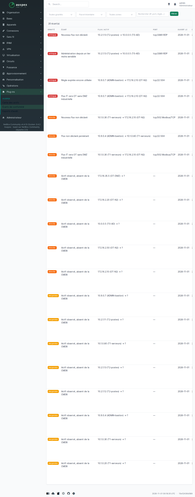

# Comprendre et traiter les écarts

Un écart, c'est une différence entre **ce que vous avez déclaré** (vos règles
de flux, votre inventaire) et **ce qu'Auspex voit** sur le réseau. Ce n'est
pas forcément une attaque : c'est souvent un oubli, une règle mal écrite ou
un inventaire pas à jour. Mais chaque écart mérite une décision.

## La page « Écarts de conformité »

Menu **Plug-ins → Auspex → Écarts de conformité**. Elle liste tous les écarts
ouverts, avec des filtres en haut :

- **gravité** : pour ne voir que le plus urgent ;
- **flux ou inventaire** : les écarts de communication, ou ceux de l'inventaire ;
- **zone** : pour un responsable qui ne s'occupe que d'une partie du réseau ;
- **recherche libre** : une adresse IP, un port, un numéro de règle.

{ loading=lazy }

## Les gravités

| Gravité | Ce que ça veut dire en pratique |
| --- | --- |
| **critique** | une zone vitale est touchée : administration du tier 0 ou d'un réseau industriel depuis une zone moins sûre, accès direct à un contrôleur de domaine. À traiter dans la journée. |
| **élevée** | flux non autorisé vers une zone sensible (tier 0, atelier, zone inconnue), flux non déclaré qui dure, actif inconnu en zone sensible. À traiter dans la semaine. |
| **moyenne** | flux non déclaré entre zones ordinaires, identification qui ne colle pas. À planifier. |
| **faible** | ménage : règle jamais utilisée, fiche d'inventaire incomplète, équipement déclaré jamais vu. |

## Les écarts de communication

### Nouveau flux non déclaré

**Ce que c'est** : deux machines communiquent et aucune règle ne l'autorise.

**Exemple** : un poste de travail ouvre un bureau à distance sur un serveur.

**Que faire** : demandez au propriétaire de la machine source si c'est
normal. Si oui, ajoutez une règle dans votre tableau. Sinon, bloquez-le au
pare-feu et cherchez pourquoi il existe.

### Flux non déclaré persistant

**Ce que c'est** : le même flux non déclaré dure depuis plusieurs jours
(3 par défaut).

**Exemple** : un accès SSH ouvert pour un dépannage, jamais refermé.

**Que faire** : c'est le cas typique de l'ouverture « provisoire » oubliée.
Fermez-le, ou déclarez-le avec une date d'expiration.

### Règle expirée encore utilisée

**Ce que c'est** : un flux est couvert par une règle dont la date de fin est
passée.

**Exemple** : l'accès d'un prestataire prévu jusqu'au 15 décembre, toujours
utilisé en janvier.

**Que faire** : soit l'accès doit être coupé (prévenez l'équipe réseau),
soit il faut prolonger la règle en changeant sa date.

### Règle jamais utilisée

**Ce que c'est** : une règle de votre tableau n'a servi à aucun flux depuis
longtemps (90 jours par défaut).

**Que faire** : c'est une candidate au nettoyage. Une règle inutile est une
porte ouverte pour rien, côté pare-feu aussi.

### Administration depuis un tier moins sensible

**Ce que c'est** : un protocole d'administration (bureau à distance, SSH,
WinRM…) part d'une zone moins sensible vers une zone plus sensible.

**Exemple** : un poste utilisateur (tier 2) en bureau à distance sur un
contrôleur de domaine (tier 0).

**Que faire** : c'est exactement ce que le modèle en tiers interdit, et ce
qu'un attaquant cherche à faire. L'administration doit passer par les postes
ou bastions de la zone d'administration. Traitez en priorité, même si une
règle autorise le flux par ailleurs.

### Flux IT vers OT sans DMZ industrielle

**Ce que c'est** : une machine de l'informatique de gestion parle
directement à l'atelier, sans passer par la DMZ industrielle.

**Exemple** : un serveur qui interroge un automate en Modbus.

**Que faire** : faites passer ce flux par la DMZ industrielle (un serveur
relais, un historien). Un accès direct est la voie royale d'un rançongiciel
vers la production.

### Balayage du réseau

**Ce que c'est** : une machine tente de joindre un grand nombre d'adresses
ou de ports, la plupart sans réponse.

**Exemple** : un poste compromis qui cherche ses prochaines cibles dans
l'atelier.

**Que faire** : isolez la machine et lancez une investigation. Il n'y a
qu'une alerte par machine ; elle se ferme toute seule quand le balayage
cesse. Si c'est votre scanner de vulnérabilités, demandez à
l'administrateur de le déclarer comme autorisé.

## Les écarts d'inventaire

Ils n'apparaissent que si Auspex est relié à l'inventaire NetBox (c'est le cas
avec l'installation standard).

| Écart | Ce que c'est | Que faire |
| --- | --- | --- |
| **Actif observé, absent de la CMDB** | une machine parle sur le réseau mais personne ne l'a déclarée | identifiez-la et créez sa fiche ; si personne ne la connaît, c'est suspect |
| **Actif déclaré, non observé** | une machine déclarée dans une zone écoutée n'a jamais été vue | elle est peut-être éteinte, retirée ou mal déclarée : mettez la fiche à jour |
| **Identification divergente** | déclarée « Windows Server », Auspex voit un Linux | une des deux informations est fausse : vérifiez sur place |
| **Fiche d'inventaire incomplète** | il manque le propriétaire, le niveau de protection, la fonction ou la criticité | complétez la fiche : NIS2 et DORA exigent ces informations |

## Comment un écart se ferme

Vous ne fermez pas un écart à la main : **il se ferme tout seul quand la
cause disparaît.** Ajoutez la règle, coupez le flux ou corrigez la fiche, et
l'écart disparaît au cycle suivant (quelques minutes) ou après la période
d'observation. L'historique reste dans les rapports d'audit, avec le temps
qu'il a fallu pour le résoudre.

!!! tip "Par où commencer avec beaucoup d'écarts ?"
    Au premier démarrage, il est normal d'en avoir des dizaines. Traitez les
    **critiques** d'abord, puis filtrez par zone et voyez avec chaque
    responsable. Beaucoup d'écarts « nouveau flux » se règlent en ajoutant
    quelques règles larges et légitimes (DNS, mises à jour, sauvegarde).
