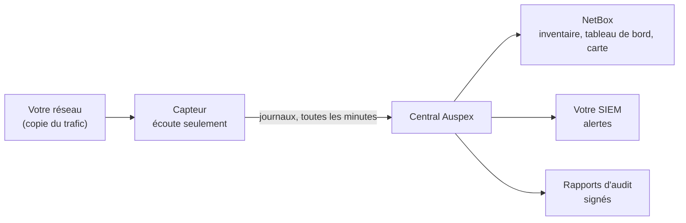

# Guide utilisateur

Ce guide explique Auspex **sans jargon technique**. Il s'adresse à celles et
ceux qui vont s'en servir : responsable de la sécurité, administrateur réseau,
responsable d'atelier, auditeur. Pas besoin d'être développeur.

Si vous cherchez le détail de chaque réglage, la
[documentation technique](../documentation/index.md) est là pour ça.

## Auspex en deux minutes

À Rome, l'auspex lisait l'avenir en observant le vol des oiseaux, sans jamais
intervenir. Auspex fait la même chose avec votre réseau : **il regarde passer
le trafic, sans rien envoyer**, et en tire trois choses.

1. **La liste de ce qui est vraiment branché** : postes, serveurs, automates,
   écrans de supervision… avec, pour chacun, ce qu'Auspex a pu deviner (le
   système, la marque, le modèle, le rôle).
2. **Les communications qui ne devraient pas exister** : vous déclarez dans
   un simple tableau Excel qui a le droit de parler à qui, et Auspex signale
   tout ce qui sort du cadre.
3. **Des preuves pour les audits** : des rapports prêts à remettre à un
   auditeur NIS2, DORA, IEC 62443, ISO 27001 ou ANSSI.

Auspex n'installe rien sur vos machines et ne leur pose aucune question.
C'est ce qui le rend sûr pour les réseaux industriels, où un simple balayage
réseau peut faire tomber un automate.

## Comment ça marche

- Le **capteur** est un petit boîtier (ou une machine virtuelle) branché sur
  une copie du trafic réseau. Il écoute et ne parle jamais sur ce réseau.
- Le **central** reçoit ce que les capteurs ont vu, l'analyse toutes les
  5 minutes et range le résultat dans **NetBox**, l'outil d'inventaire où
  vous travaillez au quotidien.
- Vous consultez tout depuis votre **navigateur**, dans NetBox : tableau de
  bord, liste des écarts, carte du réseau, rapports d'audit.

## Par où commencer

| Vous êtes… | Lisez d'abord |
| --- | --- |
| la personne qui installe Auspex | [Mettre Auspex en route](mise-en-route.md), puis [Installer un capteur](capteurs.md) |
| responsable sécurité ou réseau | [Les notions à connaître](notions.md), [Le tableau de bord](tableau-de-bord.md), [Comprendre les écarts](ecarts.md) |
| la personne qui tient l'inventaire | [L'inventaire dans NetBox](inventaire.md) |
| la personne qui gère les règles de pare-feu | [Déclarer les flux autorisés](regles-de-flux.md) |
| auditeur, ou en charge de la conformité | [Les rapports d'audit](audits.md) |
| simple utilisateur | [Se connecter](connexion.md) |

## Les pages du guide

1. [Les notions à connaître](notions.md) : zones, tiers, flux, écarts… en clair.
2. [Mettre Auspex en route](mise-en-route.md) : de l'installation au premier écart.
3. [Se connecter](connexion.md) : première connexion, double authentification, que faire en cas de blocage.
4. [Le tableau de bord](tableau-de-bord.md) : lire la page d'accueil en 30 secondes.
5. [Comprendre et traiter les écarts](ecarts.md) : chaque type d'écart, et quoi faire.
6. [La carte des actifs](carte.md) : voir le réseau d'un coup d'œil.
7. [L'inventaire dans NetBox](inventaire.md) : ce qu'Auspex observe, ce que vous déclarez.
8. [Déclarer les flux autorisés](regles-de-flux.md) : le tableau des règles, colonne par colonne.
9. [Installer un capteur](capteurs.md) : l'appliance, étape par étape.
10. [Recevoir les alertes](alertes.md) : brancher Auspex sur votre SIEM.
11. [Les rapports d'audit](audits.md) : produire, lire et transmettre un rapport.
12. [Au quotidien et en cas de problème](quotidien.md) : la routine, et les réponses aux pannes courantes.
