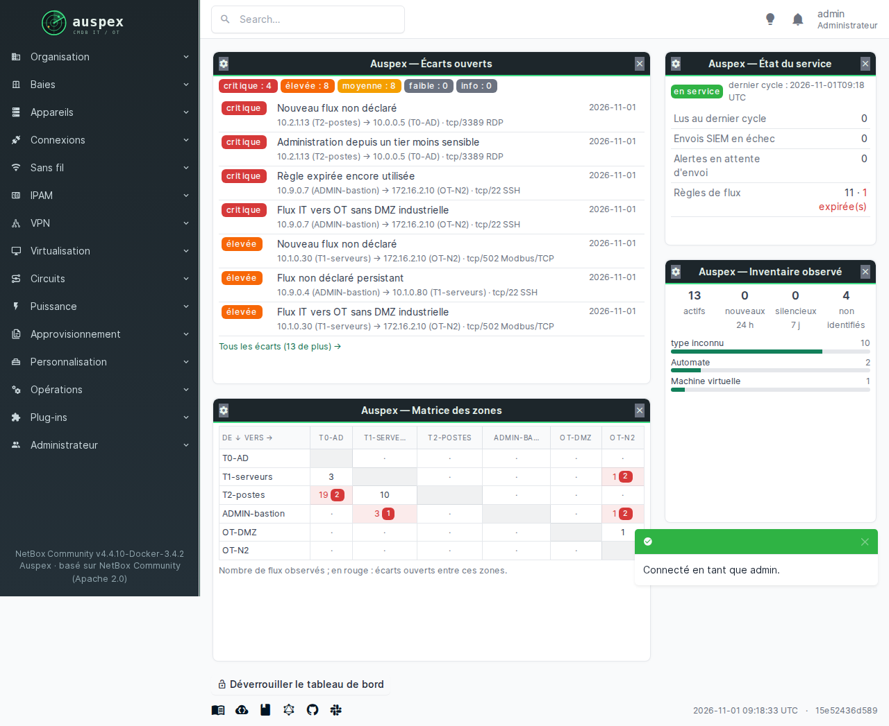
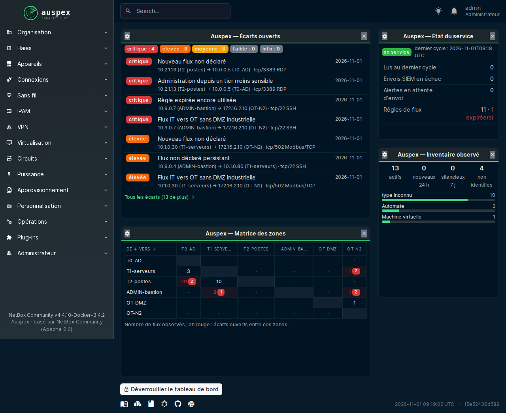

# Le tableau de bord

C'est la page d'accueil de NetBox. Auspex y ajoute quatre cadres (des
« widgets ») qui répondent en 30 secondes à la question : **est-ce que tout
va bien sur mon réseau ?**

{ loading=lazy }

## Écarts ouverts

En haut, un compteur par gravité : **critique**, **élevée**, **moyenne**,
**faible**. En dessous, les écarts du plus grave au plus ancien, avec les
deux machines concernées, leur zone et le port.

Le lien « Tous les écarts » ouvre la liste complète. Voir
[Comprendre et traiter les écarts](ecarts.md).

## État du service

Le cadre qui dit si l'on peut faire confiance au reste.

| Ligne | Ce qu'elle veut dire |
| --- | --- |
| **en service** et l'heure du dernier cycle | Auspex a analysé le trafic il y a moins de quelques minutes |
| Lus au dernier cycle | combien d'événements réseau sont arrivés des capteurs |
| Envois SIEM en échec / en attente | des alertes n'ont pas encore pu partir vers votre SIEM ; elles sont gardées et repartiront |
| Règles de flux | le nombre de règles, et en rouge celles qui ont expiré ou expirent bientôt |

!!! warning "Si l'heure du dernier cycle est ancienne"
    Le reste du tableau de bord n'est plus à jour. Voir
    [En cas de problème](quotidien.md#en-cas-de-problème).

## Inventaire observé

| Compteur | Sens |
| --- | --- |
| actifs | machines vues sur le réseau |
| nouveaux (24 h) | apparues depuis hier : à regarder en priorité |
| silencieux (7 j) | plus vues depuis une semaine : éteintes, débranchées, ou déplacées |
| non identifiés | Auspex n'a pas encore assez d'indices pour dire ce que c'est |

En dessous, la répartition par type d'équipement (vous pouvez choisir par
type, par système ou par zone dans les réglages du widget).

## Matrice des zones

Un tableau qui croise les zones : en ligne la zone qui parle, en colonne celle
qui écoute. Chaque case donne le nombre de flux observés entre les deux.
**Une case rouge** contient des écarts ; la pastille indique combien.

C'est la vue d'ensemble de votre cloisonnement : sur un réseau bien
segmenté, la plupart des cases sont vides.

## Personnaliser son tableau de bord

Chacun arrange sa page comme il veut :

1. cliquez sur **Déverrouiller le tableau de bord**, en bas de la page ;
2. déplacez ou redimensionnez les cadres à la souris, fermez ceux dont vous
   n'avez pas besoin ;
3. la roue dentée d'un cadre ouvre ses réglages (par exemple : n'afficher
   que les écarts de gravité élevée et au-dessus) ;
4. reverrouillez le tableau de bord.

Le mode sombre de NetBox s'applique aussi aux cadres d'Auspex.

{ loading=lazy }
